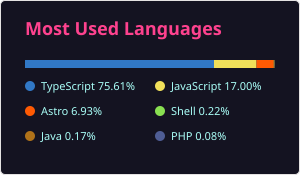

# Muhammed Riyash J — Full-Stack Developer

**React · Next.js · TypeScript · Node.js · Laravel · PostgreSQL** — headless e-commerce, payments and AI/LLM apps. Bengaluru, India.

I build the storefront a customer sees and the commerce engine behind it: server-rendered storefronts, REST APIs and business rules,
PostgreSQL/MySQL schemas, Razorpay payment flows, OTP/2FA auth, and Playwright tests that run against the live store.
3+ years, 20+ sites shipped to production.

**Open to Full-Stack Developer roles** at product, SaaS, e-commerce and AI companies — Bengaluru or remote (India).

---

## Now

**Full-Stack Developer at [Zethic Technologies](https://zethic.com), Bengaluru** (Feb 2026 – present). Company code is private; public facts:

- **Young Onion storefront** — new Astro SSR + Preact + TypeScript storefront replacing the WordPress store at youngonion.in. Top contributor: 79 of 168 merged pull requests across product pages, cart, checkout, accounts and SEO schema.
- **ZetStore** — multi-store Laravel 13 commerce platform behind GD Farm Fresh and Young Onion: GSTR-1 reports with CSV export, coupon- and shipping-aware GST, back-in-stock waitlist, and server-side checks on purchase orders, returns, stock transfers and warehouses (110 pull requests).
- **GD Farm Fresh** — live headless storefront (Astro, Preact, Tailwind CSS on Cloudflare) over the ZetStore API, with fixes covered by Playwright tests.
- **Mystery Box** — WooCommerce fulfilment plugin that fills orders automatically on payment: custom tables, REST endpoints, WP-CLI, 146 automated tests.

## Featured projects (independent builds, 2026)

| Project | What it is | Stack | Links |
|---|---|---|---|
| **360 Home Healthcare** | Live home-healthcare marketplace: five-step OTP booking, provider KYC onboarding, admin console; AES-256-GCM encrypted patient data with blind indexes | Next.js · TypeScript · Prisma · PostgreSQL · Auth.js · Tailwind CSS | [Live site](https://360homehealthcare.in/) · [Case study](https://github.com/MuhammedRiyash/doc2home-showcase) |
| **Fiomis** | Headless clothing store: Razorpay orders completed by server-side webhook, GST invoicing, append-only stock ledger, admin OTP + 2FA + RBAC | Astro · React · Medusa v2 (Node.js) · PostgreSQL · Redis · Playwright | [Case study](https://github.com/MuhammedRiyash/fiomis-showcase) |
| **Inventra** | Inventory SaaS for SMB retail/wholesale: vendors → purchase orders → warehouses → JIT → billing, 15+ inventory ratios, EOQ, 4 roles | Next.js 16 · TypeScript · Prisma · PostgreSQL · NextAuth · shadcn/ui · Vitest · Playwright | [Case study](https://github.com/MuhammedRiyash/inventra-showcase) |
| **AI content SaaS** | Turns blog posts and videos into X threads and LinkedIn carousels (unreleased) | Next.js · Claude API · OpenAI GPT API | [Ask for a walkthrough](mailto:thisismd.riyash@gmail.com?subject=AI%20content%20SaaS%20walkthrough) |
| **Portfolio** | This portfolio: case studies, printable CV, static fallback for no-JS / reduced motion | Astro · TypeScript · GSAP · three.js | [Live](https://md-riyash-portfolio.vercel.app/) · [Code](https://github.com/MuhammedRiyash/Portfolio) |
| **Services site** | Full-stack web development services site with 7 case studies | Astro · TypeScript · Tailwind CSS · GitHub Pages | [Live](https://muhammedriyash.github.io/Website/) · [Code](https://github.com/MuhammedRiyash/Website) |

Source for the private projects is shared on request — the case-study repos have a one-click access request.

## Tech stack

**Languages:** TypeScript · JavaScript (ES6+) · PHP · SQL · HTML5 · CSS3 · Python (scripting)  
**Frontend:** React · Next.js · Astro (SSR/SSG) · Preact · Tailwind CSS · Vite · Redux Toolkit · Material UI  
**Backend & data:** Node.js · Laravel · Medusa v2 · REST APIs · Prisma · PostgreSQL · MySQL · Redis  
**Payments, auth & AI:** Razorpay · OTP / 2FA / RBAC · Auth.js / NextAuth · LLM APIs (Claude, OpenAI GPT)  
**E-commerce & CMS:** headless commerce · WooCommerce (REST API, WP-CLI) · WordPress plugins · Shopify (Liquid, metafields)  
**Testing & performance:** Playwright · Vitest · PHPUnit · axe-core · Lighthouse · Core Web Vitals  
**Infra & tools:** Git · GitHub Actions · Docker · Cloudflare · Vercel · Nginx · Coolify · GTM / GA4 · Jira · Agile/Scrum

## Experience

- **Zethic Technologies LLP**, Bengaluru — Full-Stack Developer · Feb 2026 – present
- **Freelance** (remote) — Full-Stack, WordPress and Shopify Developer · Sep 2023 – Dec 2025: 12+ WordPress/Shopify sites for SMEs and startups, 3 custom plugins (lead management, WooCommerce order tracking, WooCommerce referrals), Shopify CRO on 3 stores (~10% conversion, +12% AOV)
- **Besant Technologies**, Chennai — Full-Stack Developer Intern · Jan – Aug 2023: built Taskify with React, Redux Toolkit, Material UI and Laravel REST APIs

**Education:** MCA, SRM University Sikkim (Apr 2025 – Aug 2027, expected) · B.Com, RDB College of Arts and Science (2019 – 2022)

## Languages used across my repositories (incl. private)

